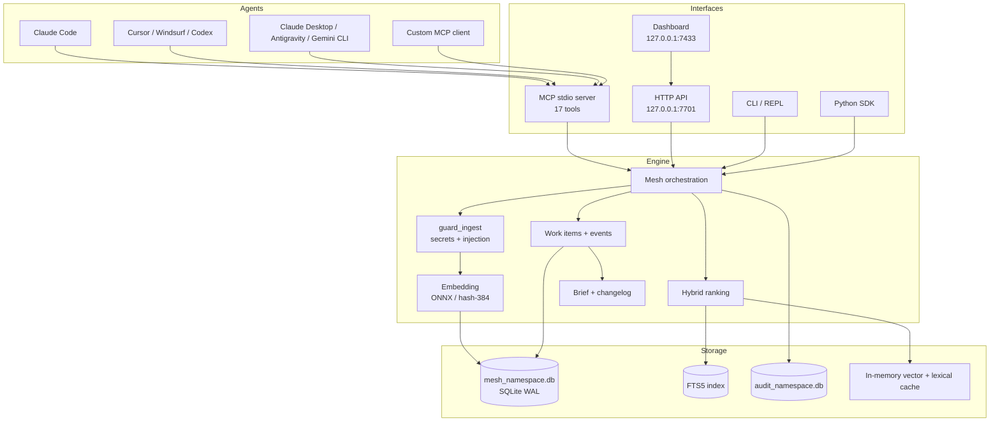
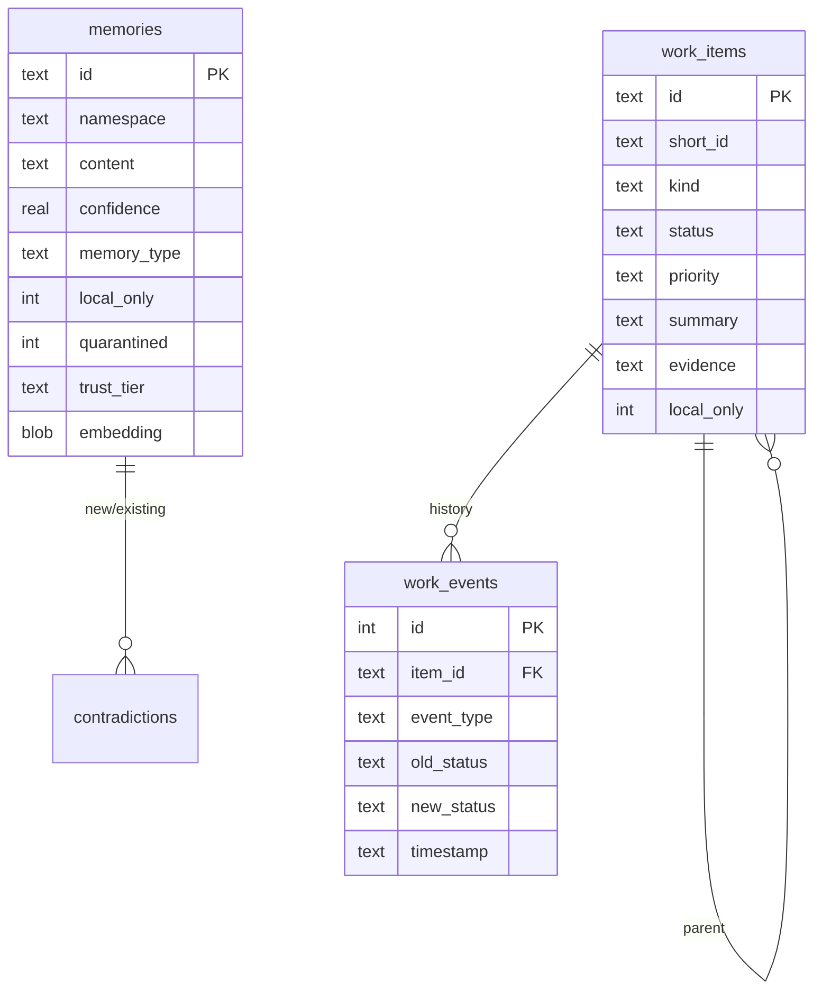
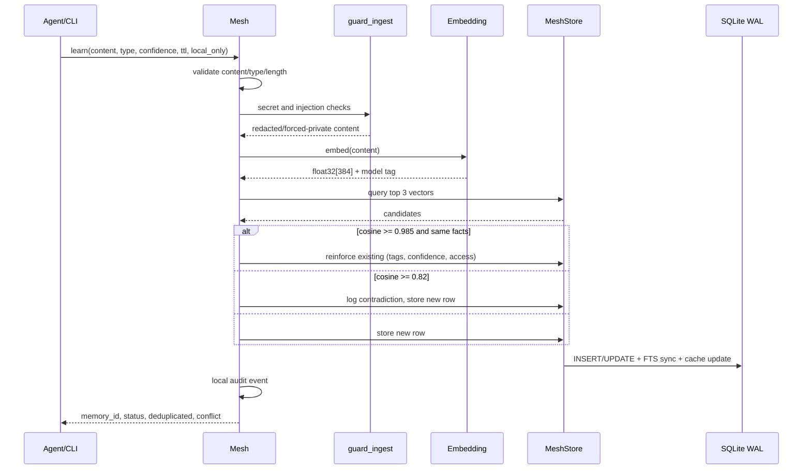
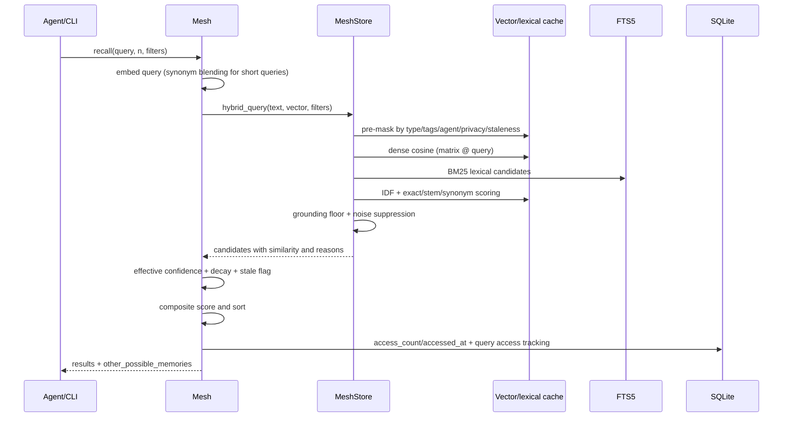
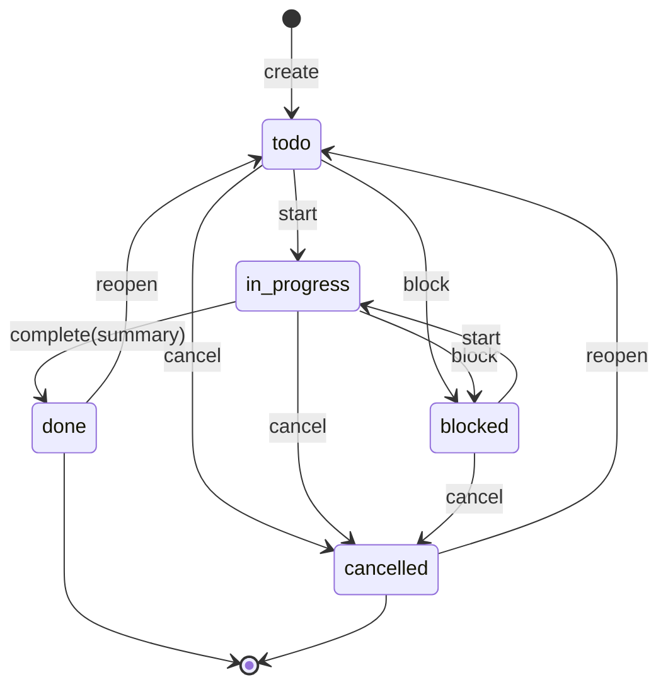
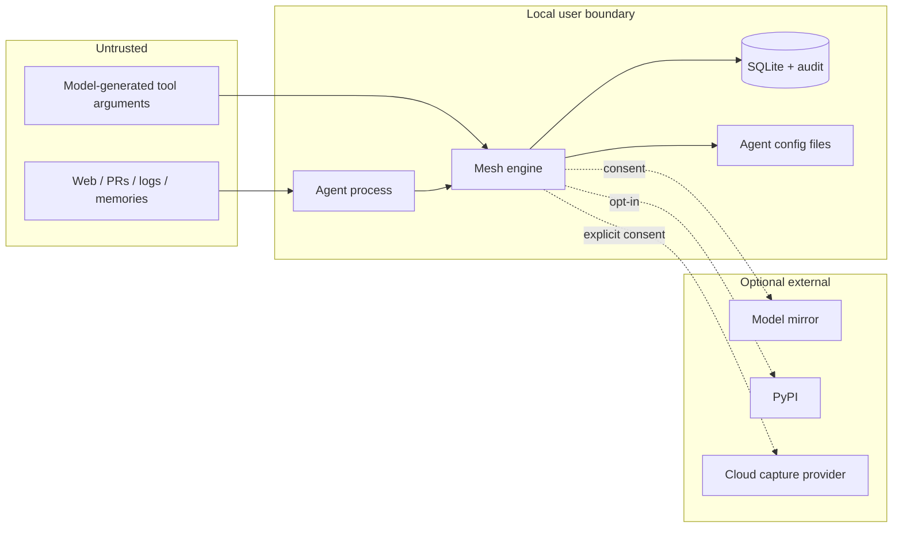

# Mesh Architecture (v0.8.3)

This document describes how Mesh is put together: modules, data flows, storage schema, search, work items, the installer, concurrency, security boundaries, configuration, and known limitations. It reflects source at commit `5348d00` (2026-10-20). User-facing instructions are in [DOCS.md](DOCS.md); development workflows are in [DEVELOPER_GUIDE.md](DEVELOPER_GUIDE.md).

---

## 1. System shape

Mesh is a Python package with one local engine and several front ends:

- **Engine:** `Mesh` (`mesh/memory.py`) orchestrates validation, guardrails, embedding, deduplication, contradiction detection, recall ranking, and work items.
- **Storage:** `MeshStore` (`mesh/store.py`) owns SQLite WAL, FTS5, the in-memory vector cache, and work-item tables.
- **Interfaces:** MCP stdio (`mesh/mcp_server.py`), HTTP (`mesh/http_server.py`), dashboard (`mesh/dashboard.py`), CLI (`mesh/cli.py`), Python SDK (`Mesh`).
- **Integration:** installer (`mesh/installer.py`), skill installer (`mesh/skill_installer.py`), daemon (`mesh/daemon.py`).
- **Cross-cutting:** guards, secrets, crypto, audit, context builder, passive capture, export/import, namespaces.



---

## 2. Repository layout

```text
mesh/
├── __init__.py              # Lazy public exports (PEP 562)
├── memory.py                # Mesh class, embeddings, recall, dedup, contradictions
├── store.py                 # SQLite schema, vector cache, hybrid query, work items, brief, log
├── guards.py                # Ingest validation, prompt-injection and secret-pattern checks
├── secrets.py               # Secret detection, redaction, keyring/vault helpers
├── crypto.py                # Optional at-rest encryption and key derivation
├── audit.py                 # Content-free local audit database
├── context_builder.py       # Prompt-safe context blocks (markdown/plain/xml/json)
├── passive.py               # Opt-in log capture and cloud-provider adapters
├── digest.py                # Recent-activity digest
├── io.py                    # Validated export/import
├── namespaces.py            # List/rename/delete/stats and cache eviction
├── daemon.py                # Background daemon, token, auto-start, HMAC handshake
├── http_server.py           # FastAPI routes and request models
├── mcp_server.py            # MCP tool definitions and daemon proxy
├── dashboard.py             # Local web UI
├── cli.py                   # `mesh` command tree
├── installer.py             # Eight agent adapters, rules/skill/MCP installation
├── skill_installer.py       # Skill-only installer and detection
├── _model_download.py       # SHA-256 verified model/tokenizer download
├── envutil.py               # Strict env parsing
├── ui.py                    # Terminal rendering
├── version.py               # VERSION, PEP 440 helpers, opt-in update check
└── skills/mesh-context-layer/
    ├── SKILL.md
    ├── rules_block.md       # Source of truth for the always-on block
    └── references/          # examples, tool reference, troubleshooting

scripts/
├── check_docs.py            # Docs/CLI/MCP/link consistency
└── check_skill.py           # Skill/rules/installer synchronization

benchmarks/
├── mesh_benchmark.py
├── scale_benchmark.py
├── concurrency_stress.py
└── RESULTS.md

tests/                       # Unit, security, retrieval, concurrency, installer, docs
```

Local data under `~/.mesh` (or `MESH_HOME`):

```text
mesh_<namespace>.db   memories, FTS5, queries, contradictions, work_items, work_events
audit_<namespace>.db  content-free audit events
.mesh_<namespace>.lock
auth_token
models/
model_status.json
.encryption_salt / .master_key / .encryption_enabled   (only when encryption is enabled)
```

---

## 3. Storage schema

Schema version: **3** (`SCHEMA_VERSION` in `store.py`). A database with a newer schema is refused; migrations create a timestamped backup before DDL.

### `memories`

Core columns: `id` (UUID), `namespace`, `content`, `confidence`, `memory_type`, `source_agent`, `tags` (JSON), `created_at`, `updated_at`, `accessed_at`, `access_count`, `ttl_days`, `decay_start_at`, `local_only`, `embedding` (float32 BLOB), `embedding_model`, `trust_tier`, `quarantined`, `secret_ref`.

### `memories_fts`

FTS5 virtual table (`porter unicode61`) with `id UNINDEXED`, `content`, `tags`, `memory_type`, `source_agent`. It is synchronized by integer `rowid` for O(log N) updates and deletes. It indexes only public, unencrypted rows; private content is excluded from the FTS index.

### `queries`

Local access tracking for patterns/gaps: `id`, `namespace`, `query_text` (redacted of secrets), `agent_id`, `best_similarity`, `result_count`, `timestamp`. Pruned to `MESH_MAX_QUERY_ROWS`. Excluded from all exports; query text recording disabled when `MESH_LOG_QUERY_TEXT=0`.

### `contradictions`

`id`, `namespace`, `new_memory_id`, `new_content`, `existing_memory_id`, `existing_content`, `similarity`, `detected_at`, `resolved`.

### `work_items`

`id` (UUID), `short_id` (`task-1`, `goal-1`), `namespace`, `kind` (`goal` or `task`), `parent_id` (self-FK), `title`, `description`, `status` (`todo`, `in_progress`, `blocked`, `done`, `cancelled`), `priority` (`low`, `medium`, `high`, `critical`), `created_by`, `created_at`, `started_at`, `completed_at`, `completed_by`, `summary`, `evidence` (JSON array), `tags` (JSON), `local_only`.

### `work_events`

Append-only lifecycle history: `id`, `item_id` (FK, cascade delete), `namespace`, `event_type`, `old_status`, `new_status`, `note`, `agent_id`, `timestamp`.

### `mesh_meta`

Key/value metadata, including `schema_version`.

Indexes cover namespace, status/priority ordering, completion time, and work-item parent lookups. The exact DDL lives in `mesh/store.py` (`_apply_schema`).



---

## 4. Learn flow



Key facts:

- Content limit: `MESH_MAX_CONTENT_LENGTH`, default 16,384 characters.
- Memory types: `fact`, `preference`, `context`, `result`, `instruction`, `process`, `decision`, `error`, `secret_ref`, `general`.
- Dedup threshold: **0.985**. Contradiction threshold: **0.82**.
- Dedup requires more than similarity: number/identifier agreement, negation polarity, and word overlap checks reduce false merges.
- A contradiction does not block the write. Both rows remain; the caller gets a conflict warning.
- If an existing row is `local_only`, its text is redacted in conflict records.
- Secret detection redacts and forces `local_only`; `--vault` stores the value in the keyring and keeps a pointer.

---

## 5. Recall flow



### Ranking

- Lexical score: `0.65 * specific_coverage + 0.35 * idf_coverage + phrase_bonus + bm25_tf_norm`.
- FTS BM25 column weights: `bm25(memories_fts, 0.0, 1.0, 0.8, 0.3, 0.2)` — content, tags, type, source.
- Final composite: `0.72 * similarity + 0.22 * effective_confidence + 0.06 * usage_boost`.
- Sort order: composite, similarity, effective confidence, access count.
- Absolute similarity floor: 0.05; hash-embedding semantic-only floor: 0.18.
- `is_stale` when effective confidence < 0.3 (decay factor × stored confidence).
- Results carry match reasons; `other_possible_memories` exposes strong matches hidden by filters.

The in-memory cache pre-tokenizes content and caches document frequencies, so IDF lookup is O(|query|) instead of re-tokenizing the corpus. The ONNX model is optional; `hash-384` is a deterministic fallback with lower semantic quality. Model swaps are tracked with an embedding-model tag so a hash vector is never mislabeled as ONNX.

---

## 6. Update and forget

- **Update:** resolve full ID from a 4+ character prefix; re-embed only if content changed; update the row and FTS; scrub old content from contradictions and audit when content changes or privacy is raised; update the cache in place.
- **Forget:** delete the row, FTS entry, cache entry, related contradiction text, and audit references.
- **Approve:** clears quarantine so the row participates in recall/context.
- **Clear TTL:** sets `ttl_days` and `decay_start_at` to NULL, making the memory permanent.

---

## 7. Work-item lifecycle

Work items are deliberately outside the memory pipeline. They are not embedded, deduplicated, contradiction-checked, or decayed.



- `create_work_item`: validates kind/priority/title, guards content, resolves a parent, assigns a per-kind short ID (`task-1`), inserts the item, and appends a `created` event.
- `update_work_item`: validates status/priority, sets `started_at` on first `in_progress`, clears completion fields on reopen, guards title/description/note, appends an event. A status may be `reopened`, which stores `todo`.
- `complete_work_item`: requires a non-empty summary, guards it, sets `done`/`completed_at`/`completed_by`, stores evidence, appends a `completed` event.
- `list_work_items`: filters by status (`open` = todo/in_progress/blocked; `closed` = done/cancelled), kind, parent; orders by priority then creation; caps at 1,000.
- `get_work_events`: reverse chronological history.
- Private work items are excluded from default lists and briefs.

### Brief

`get_project_brief(max_tokens=500)`:

1. Fetches up to 10 open items; displays up to 5, priority first.
2. Fetches up to 5 items completed in the last 48 hours; displays up to 4.
3. Fetches up to 5 key memories of type `fact`, `decision`, `process`, `preference`; excludes quarantined and (by default) private; displays up to 4.
4. Adds namespace health and a contradiction warning.
5. Truncates to `max_tokens * 4` characters and appends a notice.

An empty namespace returns a distinct `new_or_empty` state with guidance.

### Changelog

`get_changelog(since="7d")` accepts relative `s/m/h/d/w` windows or an ISO cutoff. It returns completed items plus `decision` memories created in the window, in markdown and JSON forms. Private rows are excluded by default.

---

## 8. Embeddings

- Primary: `all-MiniLM-L6-v2`, 384 dimensions, ONNX Runtime + tokenizer.
- Model directory: `~/.mesh/models/all-MiniLM-L6-v2-onnx`.
- Downloads are consent-gated, mirrored (Hugging Face and hf-mirror), revision-pinned, and checked against a SHA-256 allowlist. A 200 MB extraction cap applies.
- `MESH_NO_MODEL_DOWNLOAD=1` forces `hash-384`.
- `hash-384` is a deterministic feature-hash embedding used before the model is available and offline.
- Optional backends: PyTorch (`[pytorch]`) and FastEmbed (`[fastembed]`).
- `_EMBED_CACHE` is an LRU of `(vector, model_tag)`; default 1,024 entries.
- Rows embedded with the fallback are tracked for background healing once ONNX is available.

No embedding API is called.

---

## 9. Daemon, HTTP, MCP, dashboard

### Daemon

- Optional background process on `127.0.0.1:7701`.
- Keeps the model warm; can unload after an idle timeout.
- Token in `~/.mesh/auth_token` (0600); CLI verifies daemon identity with an HMAC challenge-response before sending the token.
- Auto-start is consent-gated and can be disabled with `MESH_NO_AUTO_DAEMON=1`.
- A Unix socket is available on POSIX.

### HTTP

- FastAPI/uvicorn. Loopback by default.
- `GET /health` is unauthenticated; every other route requires Bearer or `X-Mesh-Token`.
- `Host` header validation and loopback CORS restrict browser-origin attacks.
- Request size is bounded before body reads.
- Routes cover memory CRUD, context, audit, brief, tasks, and log. There is no `/identity` route.
- Binding to non-loopback requires `MESH_ALLOWED_HOSTS`.

### MCP

- stdio server with **17 tools**.
- Proxies through the daemon when available; uses fresh connections for mutating tools.
- Tool responses label memory content as untrusted reference data.
- Server-side environment flags can remove model control over namespace and private-data overrides.

### Dashboard

- Loopback web UI on 7433.
- Exchanges a launch token for an `HttpOnly; SameSite=Strict` session cookie and strips the token from the URL.
- Search, contradictions, patterns, audit, and keyboard shortcuts.

---

## 10. Installer

`mesh install` plans and applies changes for eight adapters: Claude Code, Claude Desktop, Antigravity, Gemini CLI, Cursor, Windsurf, OpenCode, Codex.

Per agent:

1. MCP config entry named `mesh`, using an absolute executable path.
2. Skill directory copied atomically.
3. Rules block wrapped in `<!-- mesh:begin v=<version> -->` … `<!-- mesh:end -->`.

Safety:

- `.bak-<timestamp>` backup before modification.
- Atomic writes.
- Merge, not replace: unrelated keys and servers survive.
- Marker-scoped removal on uninstall.
- Symlink rejection outside approved directories.
- `--dry-run` diffs and `--json` plans.

**Lifecycle Hooks:** `mesh install` supports optional lifecycle hooks via `--hooks` (or interactive confirmation). On supported runtimes (`ClaudeCodeAdapter` for Claude Code `.claude/settings.json` and `AntigravityAdapter` for Antigravity `.agents/hooks.json`), the installer configures a `SessionStart` command hook to run `mesh brief` when a session starts. Existing hooks and non-Mesh configurations are preserved, atomic backups are written, and `mesh uninstall` safely cleans up Mesh hook entries.

---

## 11. Audit

`audit_<namespace>.db` stores operational events from MCP, CLI, HTTP, and SDK: timestamp, surface, action, tool name, latency, counts, status, agent ID. Memory text is not stored. `mesh why` reads human-oriented events; `mesh audit export` emits JSON. Retention is capped by `MESH_MAX_AUDIT_ROWS`. Updates/deletes scrub references to removed memory text.

There is no remote telemetry or phone-home mechanism.

---

## 12. Concurrency and caching

- One SQLite database per namespace, WAL mode.
- A re-entrant in-process lock plus a cross-process file lock (`~/.mesh/.mesh_<ns>.lock`, 0600 on POSIX) serializes writes per namespace.
- A bounded connection pool (global and per-namespace caps) serves readers.
- The vector cache is copy-on-write for rows to avoid races with snapshot readers.
- FTS updates use integer rowid lookups.
- C-001 (SQLITE_MISUSE under thread contention) was fixed in 0.8.1b2 by reworking thread synchronization. Field test: 8 threads in 7.16 s with 0 errors; 16 threads in 17.11 s with 0 errors.
- Writes are serialized per namespace; this is correctness, not parallel write throughput.

---

## 13. Security and trust boundaries



- Trust boundary is the local OS user. Mesh does not defend against same-user malware or a compromised host.
- Memory and task text is untrusted reference data; it is never executed.
- `local_only` is an access filter, not encryption.
- Encryption at rest is opt-in; ordinary backups/exports are plaintext unless encrypted.
- Namespaces isolate projects, not users.
- Server flags can lock namespaces, block private overrides, enforce ownership, and enable read-only mode.
- Secret detection is heuristic. Issue T-002 was addressed by expanding prefix matching, locker codes, and task note/summary quarantine, but detection remains pattern-based; credentials should always use `secret_ref`.

See [THREAT_MODEL.md](THREAT_MODEL.md) and [SECURITY.md](SECURITY.md).

---

## 14. Configuration surface

Configuration is environment-variable based. The full user-facing table is in [DOCS.md §11](DOCS.md#11-configuration-and-environment-variables). Groups:

- storage: `MESH_HOME`, `MESH_DIR`, `MESH_NAMESPACE`
- privacy/confinement: `MESH_LOCKED_NAMESPACE`, `MESH_BLOCK_PRIVATE_OVERRIDE`, `MESH_ENFORCE_AGENT_OWNERSHIP`, `MESH_INCLUDE_PRIVATE`, `MESH_MCP_INCLUDE_PRIVATE`, `MESH_READ_ONLY`
- consent/automation: `MESH_AUTO_APPROVE`, `MESH_NON_INTERACTIVE`, `MESH_NO_AUTO_DAEMON`
- model: `MESH_NO_MODEL_DOWNLOAD`, `MESH_SKIP_CHECKSUM`, `MESH_MODEL_SHA256`, `MESH_TOKENIZER_SHA256`, `MESH_FORCE_PYTORCH`, `MESH_FORCE_FASTEMBED`
- limits: `MESH_MAX_CONTENT_LENGTH`, `MESH_MAX_NAMESPACES`, `MESH_MAX_POOL_SIZE`, `MESH_MAX_VECTOR_CACHE_SIZE`, `MESH_MAX_QUERY_ROWS`, `MESH_MAX_AUDIT_ROWS`
- network: `MESH_HTTP_HOST`, `MESH_HTTP_PORT`, `MESH_ALLOWED_HOSTS`, `MESH_UNIX_SOCKET`, `MESH_AUTH_TOKEN`
- encryption/secrets: `MESH_ENCRYPT_AT_REST`, `MESH_PASSPHRASE`, `MESH_ENCRYPTION_KEY`, `MESH_VAULT_SECRETS`
- capture/cloud: `MESH_ALLOW_LOG_SYNC`, `MESH_ENABLE_AUTO_SYNC`, `MESH_ALLOW_CLOUD_CAPTURE`, `MESH_ALLOW_CLOUD_SYNC`, `MESH_AI_PROVIDER`
- updates: `MESH_CHECK_UPDATES`, `MESH_NO_UPDATE_CHECK`

The skill's mention of `.mesh.toml` is **not implemented** in 0.8.1b2; namespace resolution is argument → `MESH_NAMESPACE` → `shared`.

---

## 15. Extension points

| Area | Where | Steps |
|---|---|---|
| MCP tool | `mesh/mcp_server.py` (`_MCP_TOOLS`, dispatch) | Add schema, dispatch branch, privacy behavior, tests, docs |
| CLI command | `mesh/cli.py` | Add parser, handler, help/examples, docs, check_docs allowlist |
| HTTP route | `mesh/http_server.py` | Add Pydantic model, route, auth, tests, docs |
| Memory type | `memory.py` / `store.py` validation and `_SORTED_MEMORY_TYPES` | Update type sets, prompts, tests, docs |
| Task field/status | `store.py` schema + validation and CLI/MCP/HTTP surfaces | Migration, validation, event handling, tests |
| Installer adapter | `mesh/installer.py` | Subclass `AgentAdapter`, add to `_ALL_ADAPTERS`, test paths, docs |
| Agent Hook | `mesh/installer.py` (`AgentAdapter.get_hooks_path`, `supports_hooks`) | Implement `get_hooks_path`, enable `supports_hooks`, support agent hook schema in `update_hooks_file` and `remove_hooks_file_entry`, add tests |
| Secret resolver | `mesh/secrets.py` | Add scheme, resolution, redaction tests, docs |
| Embedding backend | `mesh/memory.py` | Add backend with model tag, checksum/consent behavior, cache tests |

---

## 16. Tradeoffs and limitations

- **SQLite per namespace** is simple, portable, and fast for one user. It does not provide multi-user concurrency or network replication.
- **Serialized writes** protect correctness; concurrent write throughput is bounded per namespace.
- **Local hash fallback** keeps Mesh usable offline but reduces semantic quality; the 0.985/0.82 thresholds behave differently.
- **Heuristic secret detection** is convenient but incomplete; always use `secret_ref`.
- **Privacy flags** are filters, not cryptography. Encryption is opt-in.
- **Beta APIs** may change.
- **Lifecycle hooks are optional** (supported on Claude Code and Antigravity); for other agents, enforcement relies on the agent reading the rules block and choosing tools.
- **Installer adapters** are code paths, not guarantees that every third-party agent loads the config; the Claude Code `.mcp.json` mismatch was measured.
- **Field-test scope** is Windows, one model, small projects, and partly automated.
- **Benchmarks** are synthetic and hardware-specific; 100k-scale behavior is unmeasured.

---

## 17. Testing and verification

```bash
python -m pytest tests/ -q
python scripts/check_docs.py
python scripts/check_skill.py
python benchmarks/mesh_benchmark.py
```

Tests should use an isolated `MESH_HOME`, a temporary `HOME`/`USERPROFILE`/`APPDATA`/`XDG_CONFIG_HOME`, and `MESH_NO_AUTO_DAEMON=1`. See [DEVELOPER_GUIDE.md](DEVELOPER_GUIDE.md) for the exact recipe and for adding new surfaces.
