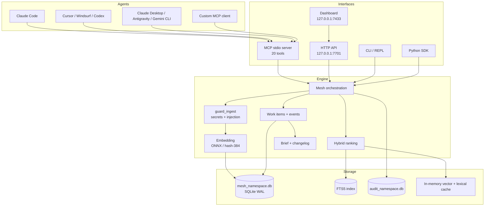
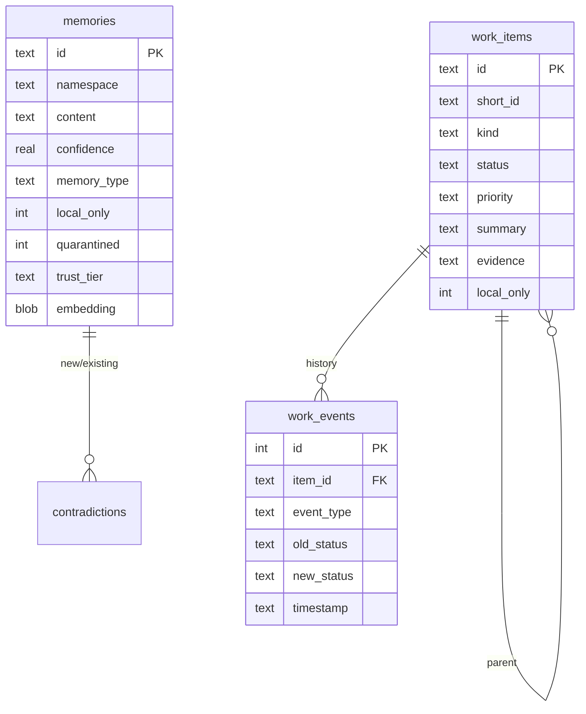
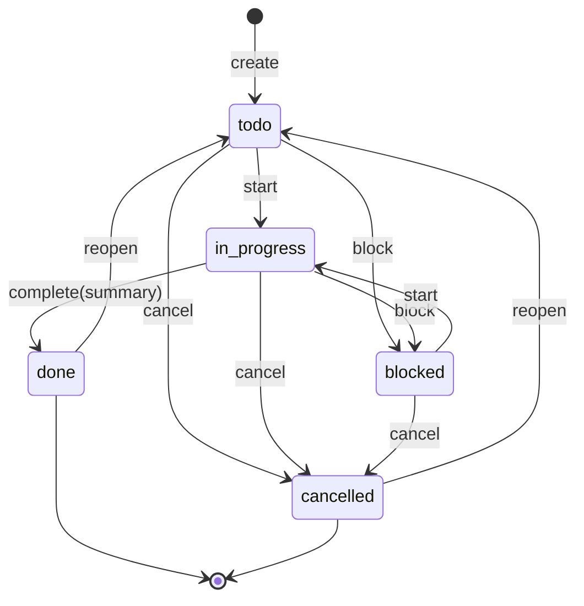
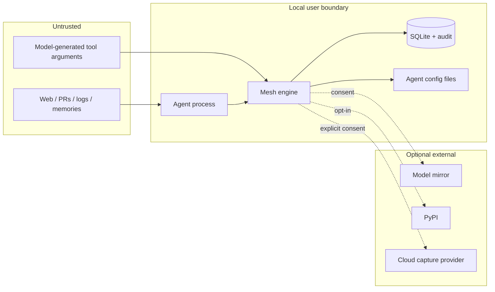

# Mesh Architecture (v0.9.0)

This document describes the 0.9.0 source branch: modules, data flows, storage schema, search, work items, installation, concurrency, and security boundaries. Historical field-test evidence is versioned separately. User-facing instructions are in [DOCS.md](DOCS.md); development workflows are in [DEVELOPER_GUIDE.md](DEVELOPER_GUIDE.md).

---

## 1. System shape

Mesh is a Python package with one local engine and several front ends:

- **Engine:** `Mesh` (`mesh/memory.py`) orchestrates validation, guardrails, embedding, deduplication, contradiction detection, recall ranking, and work items.
- **Storage:** `MeshStore` (`mesh/store.py`) owns SQLite WAL, FTS5, the in-memory vector cache, and work-item tables.
- **Runtime:** `mesh/sqlite_runtime.py` supplies one lazy DB-API facade over APSW's privately bundled patched SQLite. Storage, audit, encryption maintenance, backups, and inspection use this coherent driver; unsafe WAL engine versions are refused.
- **Shared execution:** `mesh/operations.py` applies one logical operation contract; `mesh/execution.py` bounds async offloading, and `mesh/group_commit.py` optionally aggregates compatible writes in an existing local server.
- **Interfaces:** MCP stdio (`mesh/mcp_server.py`), HTTP (`mesh/http_server.py`), dashboard (`mesh/dashboard.py`), CLI (`mesh/cli.py`), Python SDK (`Mesh`).
- **Integration:** installer (`mesh/installer.py`), skill installer (`mesh/skill_installer.py`), daemon (`mesh/daemon.py`).
- **Cross-cutting:** guards, secrets, crypto, audit, context builder, passive capture, export/import, namespaces.



---

## 2. Repository layout

```text
mesh/
├── __init__.py              # Lazy public exports (PEP 562)
├── memory.py                # Mesh class, embeddings, recall, dedup, contradictions
├── store.py                 # SQLite schema, vector cache, hybrid query, work items, brief, log
├── sqlite_runtime.py        # Lazy DB-API facade over bundled patched SQLite
├── operations.py            # Shared logical calls, policy, receipts and preparation
├── operation_contract.py    # Operation identity, digest and acknowledgement validation
├── execution.py             # Bounded offloading with caller context
├── group_commit.py          # Optional fair local write aggregation
├── mutation_delivery.py     # Bounded discovery and durable audit-outbox delivery
├── namespace_maintenance.py # Crash-recoverable namespace retirement and activation
├── namespace_resolution.py # Shared project namespace convention
├── client.py                # Verified connection profiles and SDK/HTTP access
├── hooks.py                 # Bounded profile-bound session context
├── output.py                # Per-context diagnostic routing for concurrent calls
├── guards.py                # Ingest validation, prompt-injection and secret-pattern checks
├── secrets.py               # Secret detection, redaction, keyring/vault helpers
├── crypto.py                # Optional at-rest encryption and key derivation
├── audit.py                 # Content-free local audit database
├── context_builder.py       # Prompt-safe context blocks (markdown/plain/xml/json)
├── passive.py               # Opt-in log capture and cloud-provider adapters
├── digest.py                # Recent-activity digest
├── io.py                    # Validated export/import
├── namespaces.py            # List/rename/delete/stats and cache eviction
├── daemon.py                # Background daemon, token, auto-start, HMAC handshake
├── http_server.py           # FastAPI routes and request models
├── mcp_server.py            # MCP tool definitions and daemon proxy
├── dashboard.py             # Local web UI
├── cli.py                   # `mesh` command tree
├── installer.py             # Eight agent adapters, rules/skill/MCP installation
├── skill_installer.py       # Skill-only installer and detection
├── _model_download.py       # SHA-256 verified model/tokenizer download
├── envutil.py               # Strict env parsing
├── ui.py                    # Terminal rendering
├── version.py               # VERSION, PEP 440 helpers, opt-in update check
└── skills/mesh-context-layer/
    ├── SKILL.md
    ├── rules_block.md       # Source of truth for the always-on block
    └── references/          # examples, tool reference, troubleshooting

scripts/
├── check_docs.py            # Docs/CLI/MCP/link consistency
├── run_tests.py             # Isolated homes and bounded parallel pytest workers
├── schema_sources.py        # Stdlib-only literal schema extraction for checks
└── check_skill.py           # Skill/rules/installer synchronization

benchmarks/
├── mesh_benchmark.py
├── scale_benchmark.py
├── concurrency_stress.py
└── RESULTS.md

tests/                       # Unit, security, retrieval, concurrency, installer, docs
```

Local data under `~/.mesh` (or `MESH_HOME`):

```text
mesh_<namespace>.db   memories, FTS5, queries, contradictions, work_items, work_events
audit_<namespace>.db  content-free audit events
.mesh_<namespace>.lock
auth_token
models/
model_status.json
.encryption_salt / .master_key / .encryption_enabled   (only when encryption is enabled)
```

---

## 3. Storage schema

Schema version: **6** (`SCHEMA_VERSION` in `store.py`). A database with a newer schema is refused; migrations create a verified timestamped backup before DDL. Schema 4 adds content revisions, required embedding jobs, mutation delivery, and operation receipts; schema 5 adds persistent database and memory identities; schema 6 adds passage readiness and derived vectors/offsets.

### `memories`

Core columns: `id` (UUID), `namespace`, `content`, `confidence`, `memory_type`, `source_agent`, `tags` (JSON), `created_at`, `updated_at`, `accessed_at`, `access_count`, `ttl_days`, `decay_start_at`, `local_only`, `embedding` (float32 BLOB), `embedding_model`, `trust_tier`, `quarantined`, `secret_ref`, `revision`, `incarnation`. An incarnation stays stable during edits and changes when an ID is deleted and reused.

`passage_format_version` and `passage_count` describe the complete derived generation. An empty format is pending; `paragraph-sentences-v1` with count zero reuses a verified single-window primary vector.

### `memory_passages`

Derived rows hold parent ID/revision/incarnation, namespace, ordinal, original offsets, model/representation IDs, and an encrypted-when-enabled float32 vector. No passage bodies or plaintext FTS sidecar are persisted. Publication replaces all rows, the primary vector, parent readiness and the exact durable job in one identity-checked transaction. Content/vector/model edits invalidate rows; metadata-only edits carry forward matching revisions. Delete, replacement, clear and staged namespace maintenance explicitly preserve these invariants.

### `memories_fts`

FTS5 virtual table (`porter unicode61`) with `id UNINDEXED`, `content`, `tags`, `memory_type`, `source_agent`. It is synchronized by integer `rowid` for O(log N) updates and deletes. It indexes only public, unencrypted rows; private content is excluded from the FTS index.

### `queries`

Local access tracking for patterns/gaps: `id`, `namespace`, `query_text` (redacted of secrets), `agent_id`, `best_similarity`, `result_count`, `timestamp`. Pruned to `MESH_MAX_QUERY_ROWS`. Excluded from all exports; query text recording disabled when `MESH_LOG_QUERY_TEXT=0`.

### `contradictions`

`id`, `namespace`, `new_memory_id`, `new_content`, `existing_memory_id`, `existing_content`, `similarity`, `detected_at`, `resolved`.

### `work_items`

`id` (UUID), `short_id` (`task-1`, `goal-1`), `namespace`, `kind` (`goal` or `task`), `parent_id` (self-FK), `title`, `description`, `status` (`todo`, `in_progress`, `blocked`, `done`, `cancelled`), `priority` (`low`, `medium`, `high`, `critical`), `created_by`, `created_at`, `started_at`, `completed_at`, `completed_by`, `summary`, `evidence` (JSON array), `tags` (JSON), `local_only`.

### `work_events`

Append-only lifecycle history: `id`, `item_id` (FK, cascade delete), `namespace`, `event_type`, `old_status`, `new_status`, `note`, `agent_id`, `timestamp`.

### `mesh_meta`

Key/value metadata, including `schema_version`, `namespace_owner`, `content_version`, the durable `store_generation`, and bounded-work counters. Opening a replaced or renamed database requires a new store instance.

### `embedding_jobs`

Required neural indexing work keyed by memory ID, namespace, content revision, incarnation, target model and target representation. Publication checks all of those values and the store generation in the write transaction; stale or completed work cannot overwrite a current vector. Missing neural passage generations are discovered in capacity-aware bounded batches. Unsupported or absent local passage backends leave explicit passage work pending with backoff; supported document encoding can still publish a primary vector without consuming that passage job.

### `mutation_outbox`

Content-free mutation events with stable event IDs, object IDs, revisions, and delivery timestamps. They commit with authoritative effects and are delivered to the durable audit database with deduplication.

### `operation_receipts`

Content-free results keyed by namespace, approved producer scope, and operation ID. Replays compare the operation and canonical parameter digest and recheck authorization. IDs, revisions, incarnations, and the store generation describe the accepted effects.

Indexes cover namespace, status/priority ordering, completion time, and work-item parent lookups. The exact DDL lives in `mesh/store.py` (`_apply_schema`).



---

## 4. Learn flow

```mermaid
sequenceDiagram
    participant A as Agent/CLI
    participant M as Mesh
    participant G as guard_ingest
    participant E as Embedding
    participant S as MeshStore
    participant D as SQLite WAL

    A->>M: learn(content, type, confidence, ttl, local_only)
    M->>M: validate content/type/length
    M->>G: secret and injection checks
    G-->>M: redacted/forced-private content
    M->>E: embed(content)
    E-->>M: float32[384] + model tag
    M->>S: query top 3 vectors
    S-->>M: candidates
    alt cosine >= 0.985 and same facts
        M->>S: reinforce existing (tags, confidence, access)
    else cosine >= 0.82
        M->>S: log contradiction, store new row
    else
        M->>S: store new row
    end
    S->>D: transaction: content + FTS + revision + required job/outbox/receipt
    D-->>S: WAL FULL commit
    S->>S: publish derived cache changes; release write locks
    M->>M: wake indexing and content-free audit delivery
    M-->>A: memory_id, revision, disposition, indexing_state
```

Key facts:

- Content limit: `MESH_MAX_CONTENT_LENGTH`, default 16,384 characters.
- Memory types: `fact`, `preference`, `context`, `result`, `instruction`, `process`, `decision`, `error`, `secret_ref`, `general`.
- Dedup threshold: **0.985**. Contradiction threshold: **0.82**.
- Dedup requires more than similarity: number/identifier agreement, negation polarity, and word overlap checks reduce false merges.
- A contradiction does not block the write. Both rows remain; the caller gets a conflict warning.
- If an existing row is `local_only`, its text is redacted in conflict records.
- Secret detection redacts and forces `local_only`; `--vault` stores the value in the keyring and keeps a pointer.
- Scalar and bulk calls share guarded preparation and transaction-time ownership, privacy, dedup, and revision checks. Encoding and candidate preparation run before the write transaction. `learn_many` supports ordered per-item outcomes and all-or-nothing batches, with a 128-item public limit and bounded total work.
- Durable acceptance can precede neural indexing. Acknowledged content is available through ID and lexical lookup; `wait_for_indexed` explicitly waits for semantic readiness and reports changed revisions, reused IDs, replaced stores, and missing memories.
- A receipt-bearing logical operation stores its content-free receipt atomically with its effects. Replay checks operation name, canonical parameter digest, producer scope, and current authorization; it does not copy memory bodies into receipts. Receipts are bounded and have no automatic expiry policy.

---

## 5. Recall flow

```mermaid
sequenceDiagram
    participant A as Agent/CLI
    participant M as Mesh
    participant S as MeshStore
    participant C as Vector/lexical cache
    participant F as FTS5
    participant D as SQLite

    A->>M: recall(query, n, filters)
    M->>M: encode query in configured model space
    M->>S: hybrid_query(text, vector, filters)
    S->>C: pre-mask by type/tags/agent/privacy/staleness
    S->>C: dense cosine (matrix @ query)
    S->>F: BM25 lexical candidates
    S->>C: IDF + exact/stem/synonym scoring
    S->>S: union independent lexical, exact, and compatible dense candidates
    S-->>M: candidates with similarity and reasons
    M->>M: effective confidence + decay + stale flag
    M->>M: bounded relevance ranking; current revision, incarnation, generation, and visibility check
    M->>D: access_count/accessed_at + query access tracking
    M-->>A: results + other_possible_memories
```

### Ranking

- Exact identifiers, lexical BM25, and dense cosine contribute independent bounded candidate sets. Native FTS5 participates for eligible public plaintext rows; protected in-memory lexical scoring supports application-encrypted/private rows under the caller's policy.
- Eligibility and lexical statistics are computed for authorized rows. Private/quarantined rows do not affect public ranking statistics or enter unauthorized candidate pools.
- `MESH_RECALL_FUSION=calibrated` is the default; `rrf` is an experimental ablation. Relevance/fusion scores remain separate from similarity and threshold contracts. Popularity does not receive the previous unconstrained second-pass composite boost.
- Dense pruning masks incompatible model spaces before top-k selection. Equal dimensions alone do not establish compatibility.
- Absolute similarity floor: 0.05; hash-embedding semantic-only floor: 0.18.
- `is_stale` when effective confidence < 0.3 (decay factor × stored confidence).
- Results carry match reasons, candidate counts, IDs/revisions, memory incarnations, store generations, and bounded supporting excerpts with source offsets. `other_possible_memories` exposes authorized strong matches hidden by metadata filters and preserves the same identities.

`MESH_PASSAGE_INDEX=1` activates the passage candidate; it is off by default pending independent quality/resource qualification. Text queries use it only when the authorized snapshot contains a complete compatible passage generation; hidden, incompatible or malformed bundles cannot switch the public scorer. Empty-text/vector-only learning lookups retain the primary vectors. `mesh/passages.py` preserves paragraph/sentence boundaries before normalization, using 224-token windows with 32-token overlap only inside oversized sentences; inputs within the existing 254-token single-window limit reuse their primary vector. `mesh/passage_search.py` uses body-only lexical statistics, same-passage fusion, parent candidate budgets and deterministic parent/ordinal ordering. Semantic, lexical and BM25 diagnostics describe the selected span. Parent tags remain eligibility filters. Cached matrices/offsets/lexical entries and bounded streaming/query/worker allocations use the global byte leases; insufficient workspace retires reclaimable cache generations before streaming or retrying durable work. Final results revalidate parent policy and complete identity.

The effective corpus contains compatible ready passages and implicit short/pending parents. It does not merge a separate original-primary long-parent ranking, so the earlier CI child experiment does not qualify this configuration. Standard `wait_for_indexed` remains document readiness; `target_representation="paragraph-sentences-v1"` additionally requires the complete source-bound passage generation. Import/export omit derived rows and rebuild them. Encryption activation converts existing passage vectors on store initialization; `mesh encrypt-db` also converts them in its full existing-data workflow.

A completed zero-child generation is also activation evidence: its valid compatible primary vector, current identity, representation and absence of derived rows are verified. All-short ready corpora therefore use the same body-only scorer as corpora containing ready long parents. Adding a parent may change ordinary corpus statistics and ranks; it does not change the scoring mode. The zero-capacity passage index, ready-primary IDs and body lexical entries are charged to the same cache lease.

The cache pre-tokenizes content and bounds vector, lexical, and snapshot allocations. If a namespace cannot fit its configured cache budget, retrieval scans bounded database pages and retains bounded candidate heaps rather than loading the entire namespace. Query encoding uses the verified local model when ready, independently of ingestion's fast hash stage. Query/embedding cache keys include backend identity and preprocessing role; hash and neural vectors are never mixed under one model tag.

---

## 6. Update and forget

- **Update:** resolve full ID from a 4+ character prefix; re-embed only if content changed; update the row and FTS; scrub old content from contradictions and audit when content changes or privacy is raised; update the cache in place.
- **Forget:** delete the row, FTS entry, cache entry, related contradiction text, and audit references.
- **Approve:** clears quarantine so the row participates in recall/context.
- **Clear TTL:** sets `ttl_days` and `decay_start_at` to NULL, making the memory permanent.

---

## 7. Work-item lifecycle

Work items are deliberately outside the memory pipeline. They are not embedded, deduplicated, contradiction-checked, or decayed.



- `create_work_item`: validates kind/priority/title, guards content, resolves a parent, assigns a per-kind short ID (`task-1`), inserts the item, and appends a `created` event.
- `update_work_item`: validates status/priority, sets `started_at` on first `in_progress`, clears completion fields on reopen, guards title/description/note, appends an event. A status may be `reopened`, which stores `todo`.
- `complete_work_item`: requires a non-empty summary, guards it, sets `done`/`completed_at`/`completed_by`, stores evidence, appends a `completed` event.
- `list_work_items`: filters by status (`open` = todo/in_progress/blocked; `closed` = done/cancelled), kind, parent; orders by priority then creation; caps at 1,000.
- `get_work_events`: reverse chronological history.
- Private work items are excluded from default lists and briefs.
- Task state and its lifecycle event commit in one transaction. Application encryption covers task text, summaries, evidence, tags, and event notes; authorized reads decode these fields. Mutations enforce the same enabled ownership/privacy policy as memory writes.

### Brief

`get_project_brief` defaults to a compact 500-token estimate; the agent skill requests `max_tokens=2000, max_facts=20` at session/project start.

1. Selects current fact/decision/process/preference memories, reserves fact space, and includes IDs and freshness.
2. Adds bounded open work, recent public completions, a handoff, namespace health, and contradiction notices as the budget permits.
3. Excludes unauthorized private, quarantined, and stale memories.
4. Reports available/included/omitted fact counts, continuation offset, and a selection revision. A changed revision requires refreshing before combining pages.
5. Caps `brief_markdown` at four characters per estimated token, including omission notices. `payload_estimated_tokens` reports the complete compact logical JSON payload, including its own estimate; it does not cap that payload. JSON-RPC wrappers, pretty printing, and CLI defense banners are additional transport framing. Selected memory bodies are compacted rather than returned in full. Token values are estimates, not a tokenizer guarantee.

An empty namespace returns a distinct `new_or_empty` state with guidance.

### Changelog

`get_changelog(since="7d")` accepts relative `s/m/h/d/w` windows or an ISO cutoff. It returns completed items plus `decision` memories created in the window, in markdown and JSON forms. Private rows are excluded by default.

---

## 8. Embeddings

- Primary: `all-MiniLM-L6-v2`, 384 dimensions, ONNX Runtime + tokenizer.
- Model directory: `~/.mesh/models/all-MiniLM-L6-v2-onnx`.
- Downloads are consent-gated, mirrored (Hugging Face and hf-mirror), revision-pinned, and checked against a SHA-256 allowlist. A 200 MB extraction cap applies.
- `MESH_NO_MODEL_DOWNLOAD=1` disables downloading; installed verified model files remain usable.
- `hash-384` is a deterministic feature-hash embedding used before the model is available and offline.
- Optional backends: PyTorch (`[pytorch]`) and FastEmbed (`[fastembed]`).
- Embedding/query LRUs have entry and byte budgets. They are invalidated across backend changes and preserve homogeneous model provenance in batches.
- Fallback rows have durable revision-bound jobs. A body-free bounded queue supplies wakeup hints; losing a hint does not lose required indexing work. The worker processes bounded byte batches, backs off failures, and makes progress under continuous foreground traffic.
- Long-text encoding aggregates token windows across the accepted text into one parent vector. Supporting excerpts retain source offsets. A persistent multi-vector chunk index remains an experiment in the [production plan](docs/PRODUCTION_PLAN.md).

No embedding API is called.

---

## 9. Daemon, HTTP, MCP, dashboard

### Daemon

- Optional background process on `127.0.0.1:7701`.
- Keeps the model warm; can unload after an idle timeout.
- Token in `~/.mesh/auth_token` (0600); CLI verifies daemon identity with an HMAC challenge-response before sending the token.
- Auto-start is consent-gated and can be disabled with `MESH_NO_AUTO_DAEMON=1`.
- A Unix socket is available on POSIX.

### HTTP

- FastAPI/uvicorn. Loopback by default.
- `GET /health` and `GET /ready` are unauthenticated; data and engine routes require Bearer or `X-Mesh-Token`.
- `Host` header validation and loopback CORS restrict browser-origin attacks.
- Request size is bounded before body reads.
- Routes cover memory CRUD, context, audit, brief, tasks, and log. There is no `/identity` route.
- Binding to non-loopback requires `MESH_ALLOWED_HOSTS`.

### MCP

- stdio server with **20 tools**.
- Proxies through the daemon when available; uses fresh connections for mutating tools.
- Tool responses label memory content as untrusted reference data.
- Server-side environment flags can remove model control over namespace and private-data overrides.

### Dashboard

- Loopback web UI on 7433.
- Exchanges a launch token for an `HttpOnly; SameSite=Strict` session cookie and strips the token from the URL.
- Search, contradictions, patterns, audit, and keyboard shortcuts.

---

## 10. Installer

`mesh install` plans and applies changes for eight adapters: Claude Code, Claude Desktop, Antigravity, Gemini CLI, Cursor, Windsurf, OpenCode, Codex.

Per agent:

1. MCP config entry named `mesh`, using an absolute executable path.
2. Skill directory copied atomically.
3. Rules block wrapped in `<!-- mesh:begin v=<version> -->` … `<!-- mesh:end -->`.

Safety:

- `.bak-<timestamp>` backup before modification.
- Atomic writes.
- Merge, not replace: unrelated keys and servers survive.
- Marker-scoped removal on uninstall.
- Symlink rejection outside approved directories.
- `--dry-run` diffs and `--json` plans.

**Lifecycle Hooks:** `mesh install` supports optional lifecycle hooks via `--hooks` (or interactive confirmation). Claude Code uses `SessionStart` in `.claude/settings.json`; Antigravity uses its existing `PreInvocation` event in `.agents/hooks.json`, which may run before every invocation. Both call `mesh-hook brief` through a verified project connection profile. The hook loads up to twenty facts and reports omitted facts within a budget; the skill requires topic recall before decisions. Codex lifecycle hooks remain unverified. Existing hooks and non-Mesh configuration are preserved, atomic backups are written, and uninstall removes only Mesh entries.

---

## 11. Audit

`audit_<namespace>.db` stores content-free operational events from MCP, CLI, HTTP, and SDK. Required mutations first append a durable event in the source transaction; bounded background discovery delivers it with a deduplicated event ID before acknowledging the source outbox. Failure retains the durable source event with bounded retry backoff. Read-access audit and query/access statistics use separately bounded, loss-tolerant queues whose drops are counted. `mesh why` reads events; `mesh audit export` emits JSON. Retention is capped by `MESH_MAX_AUDIT_ROWS`.

There is no remote telemetry or phone-home mechanism.

---

## 12. Concurrency and caching

- One SQLite database per namespace, WAL mode and `synchronous=FULL` on the verified patched runtime. Acknowledgements follow authoritative commits; derived cache publication happens afterward. Physical power-loss behavior still depends on storage honoring synchronization and needs hardware/filesystem testing.
- A re-entrant in-process lock plus a cross-process file lock (`~/.mesh/.mesh_<ns>.lock`, 0600 on POSIX) serializes writes per namespace.
- Bounded read-only connections provide short snapshots independently of the writer connection. Per-store state locks protect one namespace; global registry locks do not enclose cold connection creation, filesystem scans, or model work.
- Vector/lexical snapshot allocations, transaction deltas, SQLite page caches, query/embedding caches, receipts, outboxes, pending jobs, and telemetry are bounded. Large namespaces use the streaming retrieval/export paths.
- Async transports offload blocking work through a bounded executor with four workers and at most 32 admitted calls, so a normal burst from sixteen local agents can queue without creating more worker threads. Cancellation before execution releases admission when its queued runner settles; an admitted mutation keeps its receipt outcome for reconciliation after caller cancellation.
- Optional local group commits reserve bounded items/bytes, prepare outside the writer transaction, schedule by namespace/producer, and isolate each operation with a savepoint. Success is delivered only after the shared FULL commit. Direct SDK access remains supported; the broker is not an exclusive-writer claim.
- FTS updates use integer rowid lookups.
- C-001 (SQLITE_MISUSE under thread contention) was fixed in 0.8.1b2 by reworking thread synchronization. Field test: 8 threads in 7.16 s with 0 errors; 16 threads in 17.11 s with 0 errors.
- Many agents can share one authenticated server to reuse its model/cache and amortize FULL commits. Separate local processes can also cooperate through the same namespace file locks and runtime contract.

Mesh writers update the content generation, FTS, revisions, durable jobs, and
mutation history in the same transaction. Direct SQL that bypasses this protocol
is unsupported: a row-count or file-stamp change cannot detect every same-size
edit or reconstruct omitted indexes and events. Cross-process coherence tests use
the public Mesh API. Read-only inspection uses the shared patched runtime.

---

## 13. Security and trust boundaries



- Trust boundary is the local OS user. Mesh does not defend against same-user malware or a compromised host.
- Memory and task text is untrusted reference data; it is never executed.
- `local_only` is an access filter, not encryption.
- Encryption at rest is opt-in; ordinary backups/exports are plaintext unless encrypted.
- Namespaces isolate projects, not users.
- Server flags can lock namespaces, block private overrides, enforce ownership, and enable read-only mode.
- Secret detection is heuristic. Issue T-002 was addressed by expanding prefix matching, locker codes, and task note/summary quarantine, but detection remains pattern-based; credentials should always use `secret_ref`.

See [THREAT_MODEL.md](THREAT_MODEL.md) and [SECURITY.md](SECURITY.md).

---

## 14. Configuration surface

Configuration is environment-variable based. The full user-facing table is in [DOCS.md §11](DOCS.md#11-configuration-and-environment-variables). Groups:

- storage: `MESH_HOME`, `MESH_DIR`, `MESH_NAMESPACE`
- privacy/confinement: `MESH_LOCKED_NAMESPACE`, `MESH_BLOCK_PRIVATE_OVERRIDE`, `MESH_ENFORCE_AGENT_OWNERSHIP`, `MESH_INCLUDE_PRIVATE`, `MESH_MCP_INCLUDE_PRIVATE`, `MESH_READ_ONLY`
- consent/automation: `MESH_AUTO_APPROVE`, `MESH_NON_INTERACTIVE`, `MESH_NO_AUTO_DAEMON`
- model: `MESH_NO_MODEL_DOWNLOAD`, `MESH_SKIP_CHECKSUM`, `MESH_MODEL_SHA256`, `MESH_TOKENIZER_SHA256`, `MESH_FORCE_PYTORCH`, `MESH_FORCE_FASTEMBED`
- limits: `MESH_MAX_CONTENT_LENGTH`, `MESH_MAX_NAMESPACES`, `MESH_MAX_POOL_SIZE`, `MESH_MAX_VECTOR_CACHE_SIZE`, `MESH_MAX_QUERY_ROWS`, `MESH_MAX_AUDIT_ROWS`
- network: `MESH_HTTP_HOST`, `MESH_HTTP_PORT`, `MESH_ALLOWED_HOSTS`, `MESH_UNIX_SOCKET`, `MESH_AUTH_TOKEN`
- encryption/secrets: `MESH_ENCRYPT_AT_REST`, `MESH_PASSPHRASE`, `MESH_ENCRYPTION_KEY`, `MESH_VAULT_SECRETS`
- capture/cloud: `MESH_ALLOW_LOG_SYNC`, `MESH_ENABLE_AUTO_SYNC`, `MESH_ALLOW_CLOUD_CAPTURE`, `MESH_ALLOW_CLOUD_SYNC`, `MESH_AI_PROVIDER`
- updates: `MESH_CHECK_UPDATES`, `MESH_NO_UPDATE_CHECK`

The shared namespace convention prefers an explicit argument, `MESH_NAMESPACE`,
the nearest project `.mesh/namespace` marker, the Git origin repository name,
then the project folder name, with `shared` as a last resort. Explicit names and
markers preserve existing spelling; derived names are normalized. A verified
connection profile binds its namespace and data root, and server locks still
apply. `.mesh.toml` is not implemented.

---

## 15. Extension points

| Area | Where | Steps |
|---|---|---|
| MCP tool | `mesh/mcp_server.py` (`_MCP_TOOLS`, dispatch) | Add schema, dispatch branch, privacy behavior, tests, docs |
| CLI command | `mesh/cli.py` | Add parser, handler, help/examples, docs, check_docs allowlist |
| HTTP route | `mesh/http_server.py` | Add Pydantic model, route, auth, tests, docs |
| Memory type | `memory.py` / `store.py` validation and `_SORTED_MEMORY_TYPES` | Update type sets, prompts, tests, docs |
| Task field/status | `store.py` schema + validation and CLI/MCP/HTTP surfaces | Migration, validation, event handling, tests |
| Installer adapter | `mesh/installer.py` | Subclass `AgentAdapter`, add to `_ALL_ADAPTERS`, test paths, docs |
| Agent Hook | `mesh/installer.py` (`AgentAdapter.get_hooks_path`, `supports_hooks`) | Implement `get_hooks_path`, enable `supports_hooks`, support agent hook schema in `update_hooks_file` and `remove_hooks_file_entry`, add tests |
| Secret resolver | `mesh/secrets.py` | Add scheme, resolution, redaction tests, docs |
| Embedding backend | `mesh/memory.py` | Add backend with model tag, checksum/consent behavior, cache tests |

---

## 16. Tradeoffs and limitations

- **SQLite per namespace** is simple, portable, and fast for one user. It does not provide multi-user concurrency or network replication.
- **Serialized writes** protect correctness; concurrent write throughput is bounded per namespace.
- **Local hash fallback** keeps Mesh usable offline but reduces semantic quality; the 0.985/0.82 thresholds behave differently.
- **Heuristic secret detection** is convenient but incomplete; always use `secret_ref`.
- **Privacy flags** are filters, not cryptography. Encryption is opt-in.
- **Beta APIs** may change.
- **Lifecycle hooks are optional** (supported on Claude Code and Antigravity); for other agents, enforcement relies on the agent reading the rules block and choosing tools.
- **Installer adapters** are code paths, not guarantees that every third-party agent loads the config; the Claude Code `.mcp.json` mismatch was measured.
- **Field-test scope** is Windows, one model, small projects, and partly automated.
- **Benchmarks** are synthetic and hardware-specific; 100k-scale behavior is unmeasured.

---

## 17. Testing and verification

```bash
python scripts/run_tests.py --workers 2 -- -q
python scripts/check_docs.py
python scripts/check_skill.py
python benchmarks/mesh_benchmark.py
```

Tests should use an isolated `MESH_HOME`, a temporary `HOME`/`USERPROFILE`/`APPDATA`/`XDG_CONFIG_HOME`, and `MESH_NO_AUTO_DAEMON=1`. See [DEVELOPER_GUIDE.md](DEVELOPER_GUIDE.md) for the exact recipe and for adding new surfaces.
