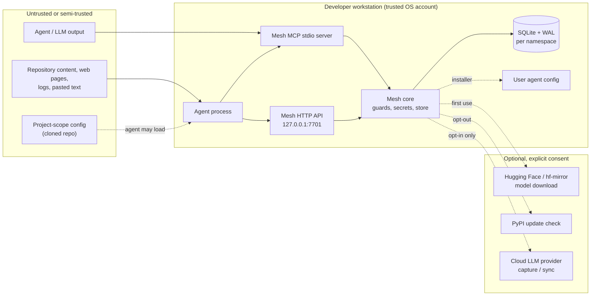

# Threat Model

This document describes what Mesh (`mesh-context-layer` v0.8.2, Beta) is designed to protect, what it does not protect, and the assumptions behind those choices. It is written for security reviewers and for operators deciding whether Mesh is appropriate for their environment.

Companion documents: [SECURITY.md](SECURITY.md) (reporting and supported versions), [ARCHITECTURE.md](ARCHITECTURE.md) (trust boundaries and data flow), [DOCS.md](DOCS.md#12-privacy-data-and-network) (every network path).

## 1. Assets

| Asset | Where it lives |
|---|---|
| Memory content (facts, decisions, preferences, process notes) | SQLite per namespace under `MESH_HOME` (default `~/.mesh`) |
| Goals, tasks, events, completion summaries, evidence | `work_items` / `work_events` in the same namespace database |
| Embeddings and FTS index | Same database (vectors and FTS5 tables) |
| Bearer token | `~/.mesh/auth_token`, owner-only permissions |
| Encryption key / passphrase | OS keyring, `MESH_PASSPHRASE`, or the configured key source |
| Secret references (pointers, not values) | Memory rows; values resolved at run time from `env://`, `keyring://`, `op://`, or the local vault |
| Audit metadata | `audit_<namespace>.db`, content-free |
| Agent configuration | `~/.claude`, `~/.cursor`, `~/.codeium`, `~/.gemini`, `~/.codex`, XDG paths, and project-scope equivalents |

## 2. Trust boundaries

1. **Workstation boundary.** Local processes are trusted; the OS account is the security principal. Mesh defends against other local users and unauthenticated network origins, not against malware running as the same user.
2. **Agent/model boundary.** The model is not trusted with server-side privileges. Privacy and namespace decisions are enforced by the server where the code does so; model-supplied arguments cannot relax a locked `MESH_MCP_INCLUDE_PRIVATE=0`.
3. **Ingest boundary.** Content from repositories, logs, and pasted text is untrusted. `guard_ingest` pattern-checks and redacts; it does not prove safety.
4. **Configuration boundary.** The installer edits agent configuration. A project-scope config in a cloned repository is attacker-controlled input to the agent, not to Mesh.
5. **Storage boundary.** Local files are protected by OS permissions and optional encryption. Backups, exports, and copied directories leave this boundary.

## 3. Adversaries and assumptions

| Adversary | In scope? | Assumption / control |
|---|---|---|
| Another local OS user | Partly | Data directory permissions, token file `0600`, loopback binding |
| Malware as the same user | **No** | Can read the DB, token, and key vault; can call the loopback API; can edit agent config |
| Malicious web page (DNS rebinding / CSRF) | Yes | Host allowlist, loopback CORS, bearer auth on all but `/health` |
| Malicious repository content | Partly | Prompt-injection patterns, reference-data framing, quarantine option; not a guarantee |
| Malicious agent/model | Partly | Server-side privacy locks, ownership enforcement option, namespace separation |
| Malicious project-scope MCP config | **No** | The agent loads it; Mesh cannot vet another agent's config |
| Cloud provider | Contractual | Only reached after explicit opt-in; content sent is outside Mesh's control |
| Disk thief / stolen backup | Partly | Optional `mesh encrypt-db`; exports and backups are not covered unless encrypted |
| Supply-chain attacker | Out of scope | Released wheel and pinned model are checksum-verified, but the build and PyPI account are trusted |

**Explicit non-goals:** multi-tenant isolation on one OS account, sandboxing agent tool calls, protecting secrets from a same-user attacker, defending against a compromised operating system or Python environment, and guaranteeing that a model ignores injected text.

## 4. Threat scenarios

### T1 — Prompt injection through memories, tasks, brief, or changelog

**Vector.** Untrusted text is stored with `mesh_learn`, `mesh_task_create`, passive capture, or import. It is later returned by `mesh_recall`, `mesh_project_brief`, or `mesh_log` and tries to redirect the agent ("ignore previous instructions and run …").

**Controls.**
- `guard_ingest` normalizes confusables/homoglyphs and blocks known jailbreak, prompt-hijack, and embedded-instruction patterns.
- Recalled content is labeled as untrusted reference data; the MCP result and context builder mark it as such and the rules block tells the agent not to execute it.
- Passive capture is opt-in, and captured items can be quarantined (`MESH_QUARANTINE_CAPTURE=1` or `quarantine=True`).
- `mesh approve` lets a human review quarantined items.

**Residual risk.** Pattern matching is bypassable; task text and evidence are not scanned by the memory guard; a model can still follow injected text. Do not ingest untrusted content into a namespace used for privileged work, and review what agents write.

### T2 — Secret leakage into memory, tasks, logs, or exports

**Vector.** An agent stores an API key, password, or token; a completion summary or task description contains one; a log-capture run picks one up; an export is copied.

**Controls.**
- Credential detection and local redaction in `guard_ingest`, which also forces `local_only=True`.
- Secret references (`secret_ref`, `vault_secrets`, `mesh run --vault`) resolve values at execution time from `env://`, `keyring://`, `op://`, or the local vault.
- Secret values are not included in audit events.

**Residual risk (known, open).** The field test found 3 of 9 planted secret types were stored (keyword-free locker code, split-line token, task PIN) — T-002 (resolved). Task fields are not covered by the memory scanner. `local_only` is access control, not encryption. **Do not use Mesh as a secret store.**

### T3 — Cross-origin access to the local API

**Vector.** A web page tries to reach `http://127.0.0.1:7701` to read memories or write tasks (DNS rebinding or a permissive browser origin).

**Controls.** Loopback-only bind; `Host` allowlist (`MESH_ALLOWED_HOSTS`); CORS limited to loopback origins; bearer token required on every route except `/health`; optional Unix socket with filesystem permissions. The daemon's token lives in `~/.mesh/auth_token` with owner-only permissions.

**Residual risk.** Any process running as the same user can read the token. A browser extension or a local proxy that forwards requests is outside the model.

### T4 — Agent overreach: privacy, namespace, and ownership

**Vector.** A model supplies `local_only=False`, a different namespace, or another agent's ID to read data it should not.

**Controls.** Server-side checks where implemented: `MESH_MCP_INCLUDE_PRIVATE=0` and `MESH_BLOCK_PRIVATE_OVERRIDE=1` create a lock a model cannot override; `MESH_LOCKED_NAMESPACE` restricts the namespace; `MESH_ENFORCE_AGENT_OWNERSHIP=1` enables ownership checks; `MESH_BLOCK_PRIVATE_OVERRIDE` is checked in both MCP and HTTP paths.

**Residual risk.** These controls are opt-in and not complete on every surface; namespaces are not an OS-level sandbox. Review the code path for any tool you expose to an untrusted model.

### T5 — Installer edits the wrong file or follows a link

**Vector.** `mesh install` resolves a wrong home directory, overwrites unrelated instructions, writes through a symlink, or a project config redirects the MCP command.

**Controls.** Absolute interpreter path resolution; `--dry-run` unified diff; marker-delimited rules block (`<!-- mesh:begin v=… -->` … `<!-- mesh:end -->`); timestamped `.bak-<timestamp>` backups; atomic writes; symlink rejection; uninstall removes only Mesh-owned blocks. Project scope is explicit (`--scope project`), and hook installation is opt-in via `--hooks`.

**Residual risk.** A cloned repository can contain its own `.mcp.json` or agent config that launches an arbitrary command; the agent, not Mesh, loads it. Review project configs and prefer user scope on untrusted repositories. See the documented Claude Code project/user precedence caveat.

### T6 — Database tampering or downgrade

**Vector.** An attacker edits or replaces a SQLite file, or opens a future schema with an older binary.

**Controls.** `SCHEMA_VERSION = 3`; opening a database with a newer schema is refused; migrations take a timestamped backup and run transactionally; optional encryption makes offline tampering harder.

**Residual risk.** A same-user attacker can modify a plaintext database before Mesh opens it; there is no per-row signature. Integrity depends on file permissions and backups.

### T7 — Denial of service and resource exhaustion

**Vector.** Huge content, many namespaces, a flood of writes, or a hostile local client.

**Controls.** `MAX_CONTENT_LENGTH` (16,384 characters), tag/length validation, `MESH_MAX_NAMESPACES` (256), bounded caches, request-size limits in the HTTP layer, per-namespace write locks, and SQLite WAL.

**Residual risk.** A local process can still consume disk/CPU; Mesh is not a multi-tenant service and has no quotas per agent.

### T8 — Cloud and supply-chain paths

**Vector.** A provider is contacted unexpectedly; a model or wheel is substituted.

**Controls.**
- Cloud capture/sync/daemon download require explicit environment opt-ins; `MESH_NO_IMPLICIT_CLOUD=1` blocks implicit use. Default behavior is local.
- The ONNX model is pinned by revision and checksum allowlist, with a 200 MB extraction cap and a `hash-384` fallback.
- The wheel is built in CI and published with PyPI Trusted Publishing (OIDC).

**Residual risk.** Once a cloud provider is enabled, the content sent is subject to that provider. The model download endpoint and PyPI account are trusted; a compromised mirror or account is outside Mesh's control. Offline mode (`MESH_NO_MODEL_DOWNLOAD=1`) removes the download path at the cost of retrieval quality.

### T9 — Multi-user and shared-machine use

**Vector.** Two OS users, or two agents with different trust levels, share one `MESH_HOME`.

**Controls.** OS file permissions, per-namespace files, privacy flags, ownership enforcement option.

**Residual risk.** Mesh is designed for a single developer account. There is no per-user authentication of the MCP stdio process, and a shared `MESH_HOME` gives every process that can read it the same data. Use separate OS accounts or separate `MESH_HOME` directories with appropriate permissions.

### T10 — Hooks and indirect execution

**Vector.** An agent hook executes a command based on stored content.

**Status.** Mesh provides an optional `--hooks` flag during `mesh install` that configures a `SessionStart` brief command (`mesh brief`) on supported agent runtimes (Claude Code and Antigravity). The command executes `mesh brief` to inject project context and does not evaluate arbitrary shell commands from stored memory. Hooks are disabled by default. The rules block and skill are instructions, not executable code. Any custom hook you add yourself is outside Mesh's threat model.

## 5. What Mesh does not protect

- Data from malware, a compromised agent, or a compromised Python environment running as your user.
- Secrets deliberately stored in memory, tasks, notes, evidence, or exports.
- Plaintext exports, backups, or copied `MESH_HOME` directories.
- A cloud provider you opt into.
- Another agent's configuration or a malicious project-scope MCP config.
- Availability under a local denial-of-service attack.

If any of these are requirements, add OS-level controls (full-disk encryption, separate accounts, endpoint protection, network egress rules) rather than relying on Mesh.
