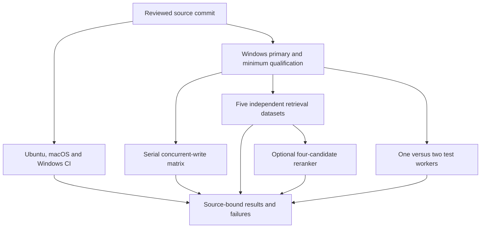

# Remote qualification for Mesh 0.9.0

The production changes and reviewed measurement utilities are published on
`ci/mesh-production-run-c4-20261106`. At `6060925`, [normal CI](https://github.com/billighost/Mesh/actions/runs/42338200399)
passed all fifteen OS/Python combinations, packaging, security, documentation,
skills and installed-wheel checks. [Production qualification](https://github.com/billighost/Mesh/actions/runs/42338200383)
passed the primary and minimum full isolated suites, real process-crash recovery,
coverage and primary installed-wheel validation. Its performance matrix and
same-selection one-versus-two-worker observations also completed successfully.
The source-bound numerical results and resource deferrals are published in
[RESULTS.md](../benchmarks/RESULTS.md).

The foreground-progress and test-fixture interference repairs are qualified.
Reviewed HTTP clients reuse bounded connections while proving identity afresh on
every call, including rejecting a closed identity connection before token dispatch.

Retrieval reached native scoring. Two supervisor projection contracts still
require repair: the legacy child experiment omitted local model hashes, and
source-accounted public parents with no faithful source alias must retain their
rank with zero relevance credit. The schema-6 production passage candidate has
focused coverage and a separate opt-in fresh-query evaluation, with exact parent,
model, original-span and source pairing checks. Final same-source passage,
retrieval and supported-platform qualification remains pending; focused checks
do not replace those gates.

The development machine has 8 GiB RAM. Local work uses small isolated checks
with one test worker and no model or corpus evaluation. Full suites, concurrent
workloads, and model evaluations run on GitHub-hosted runners.

## Qualification and measurement flow

[Normal CI](../.github/workflows/ci.yml) runs lint, security, documentation and
skill checks, full suites with the existing property-test and coverage gates on
Python 3.10–3.14 across three operating systems, and installed-wheel validation.
The source archive must also contain the helpers needed to collect its bundled
tests; Actions checks the extracted archive in an isolated environment.

[Production qualification](../.github/workflows/production-performance.yml)
tests its exact commit on Windows with Python 3.14.0 and Python 3.10. The minimum
job pins APSW 3.51.3.0. Both suites must pass; the primary also validates process
crash recovery, at least 60% coverage, and the built package. Each job records
source hashes and exact installed dependency versions before measurement.

Qualification is scheduled independently for each Python kind. Performance
matrices and test-speed observations keep separate per-branch concurrency groups,
so an older matrix does not delay qualification or retrieval of a repaired source.

Measurements use those source hashes and dependency constraints. A missing
qualification artifact, changed source, failed integrity check, unknown receipt,
or executed workload failure prevents a successful final result. Artifacts
preserve failures and explicit resource or budget deferrals.

## Registered workloads

| Job | Scope and purpose |
| --- | --- |
| Concurrent storage | Five pilots, 48 serial primary cells with 512 input facts, scalar and atomic calls, receipt SDK and HTTP, hash and neural modes, and one/four/eight/sixteen local agents |
| Scale extension | Four conditional sixteen-agent HTTP cells with 10,000 input facts; requires declared RAM, readiness and time-budget gates |
| Retrieval | NFCorpus, SciFact, direct facts, positional long memories, and the inspected six-case LongMemEval fixture; keeps guarded, saved-vector replay, fresh default queries, child-passage experiments and opt-in production passage queries separate |
| Optional C4 | Reranks four authorized parent candidates in a separate experiment; requires complete paired quality accounting and fixed RAM, CPU and latency limits |
| Test speed | Runs the same full selection once with one worker and once with two; retains source, dependency, seed, skipped-test and resource accounting |

The production process-tree RSS cap defaults to 4,096 MiB, with 2 GiB of runner
headroom. Larger scenarios can be deferred when their measured resource
projection is unsafe. Retrieval uses whole-run wall, sampled RSS and CPU limits.
The optional reranker uses stricter incremental resource limits documented in
[RETRIEVAL_C4.md](../benchmarks/RETRIEVAL_C4.md). None of these registered budgets
is a measured speed or accuracy claim.

The accuracy gates treat retrieval misses as failures. A passage experiment
can pass its gate without qualifying the current
fresh-query default. Selecting a production representation or model still
requires the relevant quality, identity, privacy, resource and regression
checks to pass.

## Starting the remote checks

An ordinary `ci/mesh-production-*` branch runs qualification. A reviewed
`ci/mesh-production-run-*` branch also requests performance, retrieval and test
speed. The narrower `ci/mesh-production-run-c4-*` prefix explicitly requests
the optional reranker experiment. Manual workflow dispatch exposes equivalent
controls and can reduce the registered scope.

The maintainer explicitly authorized publishing this CI branch, overriding the
repository [AGENTS.md](../AGENTS.md) push restriction for this work. Subsequent
repairs use ordinary commits and fast-forward pushes to the same branch.
Scoped GitHub access reads run status and evidence without exposing credentials.

## Evidence required before completion

Final completion requires passing normal CI and same-source production
qualification, followed by the relevant successful measurements and retrieval
gates. Performance claims must be published with their tested version and
provenance in [RESULTS.md](../benchmarks/RESULTS.md). Failed or deferred cells
remain visible. Process-death tests support crash recovery; physical power-cut
qualification remains separate hardware/filesystem work.
