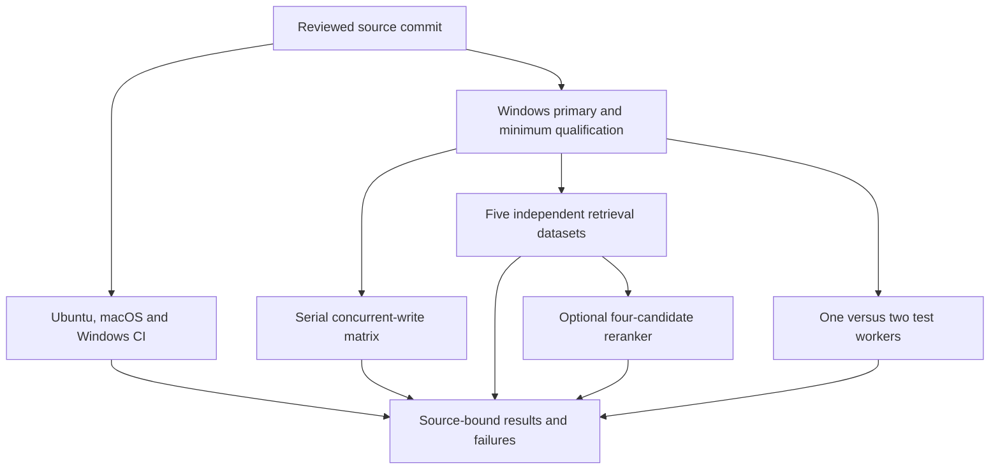

# Remote qualification for Mesh 0.9.0

At `e353bc1`, [normal CI](https://github.com/billighost/Mesh/actions/runs/42378934838)
passed, and [the production run](https://github.com/billighost/Mesh/actions/runs/42378934727)
passed both full qualification suites, the concurrent-write matrix, and the
same-selection test-speed comparison. The immutable SQLite snapshot repair is
verified in native retrieval runs. [RESULTS.md](../benchmarks/RESULTS.md) records
the tested source and retains earlier evidence.

Retrieval qualification still fails. Compact native reranker conditions meet
their own gates on the direct-fact and positional long-text fixtures, while the
inspected LongMemEval conditions miss the accuracy target. Some full-length
conditions exceed the incremental resource limits. Every public-corpus job
exceeds the unchanged cumulative CPU budget; the completed SciFact passage
condition attributes most worker CPU to queries. No profile qualifies across
all evaluated datasets. Baseline failures, rejected profiles, and unscored
phases remain visible; passing storage tests do not waive retrieval gates.

The current cache repair omits redundant primary lexical terms only for complete
validated long-parent passage generations, with a complete primary streaming
fallback. Its focused tests pass; public cache admission, CPU use, and accuracy
still require a source-bound Actions run. Post-export native reranker diagnostics
record candidate ranks and input geometry after scoring, without exposing text
or changing ranking inputs. They can identify an evidence-prefix limitation or
an inside-prefix miss; they cannot infer answer-span containment from document
relevance labels.

Completed passage queries retain numeric cache charges and returned-result
cache/streaming counts. Flushed query-resource rows and atomic provenance
checkpoints also preserve partial work after process termination, including the
fixed baseline and C4 roles. Supervisors read them after workers stop; progress
remains unscored and cannot satisfy completion, accuracy, or resource gates.

The production changes and reviewed measurement utilities are published on
`ci/mesh-production-run-c4-20261106`. At `6060925`, [normal CI](https://github.com/billighost/Mesh/actions/runs/42338200399)
passed all fifteen OS/Python combinations, packaging, security, documentation,
skills and installed-wheel checks. [Production qualification](https://github.com/billighost/Mesh/actions/runs/42338200383)
passed the primary and minimum full isolated suites, real process-crash recovery,
coverage and primary installed-wheel validation. Its performance matrix and
same-selection one-versus-two-worker observations also completed successfully.
The source-bound numerical results and resource deferrals are published in
[RESULTS.md](../benchmarks/RESULTS.md).

The foreground-progress and test-fixture interference repairs are qualified.
Reviewed HTTP clients reuse bounded connections while proving identity afresh on
every call, including rejecting a closed identity connection before token dispatch.

At `ecd96b5`, [normal CI](https://github.com/billighost/Mesh/actions/runs/42342135569)
also passed all fifteen combinations, and [production qualification](https://github.com/billighost/Mesh/actions/runs/42342135644)
passed the primary and minimum suites, crash recovery and primary package checks.
Native scoring exposed optional-ordinal metadata incompatibility in the legacy
child experiment. The latest focused repairs preserve absent-ordinal semantics
and record content-free worker diagnostics. Completed zero-child primary
generations now activate the same authorized scorer as long-parent generations.

The production passage condition runs after its fresh-default pair and before
legacy experiments; its evidence survives a later experimental failure. Exact
parent, model, span, readiness and source pairing checks remain required. Final
native passage and retrieval qualification remains pending. At `675970f`,
[normal CI](https://github.com/billighost/Mesh/actions/runs/42344319962) passed all
fifteen combinations, and both full production qualification suites passed in
[the production run](https://github.com/billighost/Mesh/actions/runs/42344319969).
Worker diagnostics identified a string-versus-integer schema check that stopped
the retrieval experiment before passage indexing. The repaired benchmark boundary
accepts only canonical schema 6 and records its numeric form consistently.
Focused checks do not replace corrected native quality and resource gates.

At `7ee42afb`, [normal CI](https://github.com/billighost/Mesh/actions/runs/42346677047)
and both full qualification suites in
[the production run](https://github.com/billighost/Mesh/actions/runs/42346677098)
passed. That production run failed retrieval qualification: the bounded fixtures
retained first-result misses, and passage backfill stalled on both public corpora.
The latest reviewed changes add a default-off production reranker and actual
`Mesh.recall` qualification paired with the ordinary runtime passage results.
They also protect active passage backfill and reranker inference from idle model
unloading. A small integrated Python 3.10 check passed; native quality and resource
qualification of these changes remains pending.

The development machine has 8 GiB RAM. Local work uses small isolated checks
with one test worker and no model or corpus evaluation. Full suites, concurrent
workloads, and model evaluations run on GitHub-hosted runners.

## Qualification and measurement flow

[Normal CI](../.github/workflows/ci.yml) runs lint, security, documentation and
skill checks, full suites with the existing property-test and coverage gates on
Python 3.10–3.14 across three operating systems, and installed-wheel validation.
The source archive must also contain the helpers needed to collect its bundled
tests; Actions checks the extracted archive in an isolated environment.

[Production qualification](../.github/workflows/production-performance.yml)
tests its exact commit on Windows with Python 3.14.0 and Python 3.10. The minimum
job pins APSW 3.51.3.0. Both suites must pass; the primary also validates process
crash recovery, at least 60% coverage, and the built package. Each job records
source hashes and exact installed dependency versions before measurement.

Qualification is scheduled independently for each Python kind. Performance
matrices and test-speed observations keep separate per-branch concurrency groups,
so an older matrix does not delay qualification or retrieval of a repaired source.

Measurements use those source hashes and dependency constraints. A missing
qualification artifact, changed source, failed integrity check, unknown receipt,
or executed workload failure prevents a successful final result. Artifacts
preserve failures and explicit resource or budget deferrals.

## Registered workloads

| Job | Scope and purpose |
| --- | --- |
| Concurrent storage | Five pilots, 48 serial primary cells with 512 input facts, scalar and atomic calls, receipt SDK and HTTP, hash and neural modes, and one/four/eight/sixteen local agents |
| Scale extension | Four conditional sixteen-agent HTTP cells with 10,000 input facts; requires declared RAM, readiness and time-budget gates |
| Retrieval | NFCorpus, SciFact, direct facts, positional long memories, and the inspected six-case LongMemEval fixture; keeps guarded, saved-vector replay, fresh default queries, child-passage experiments and opt-in production passage queries separate |
| Optional C4 | Reranks four authorized parent candidates in a separate experiment; requires complete paired quality accounting and fixed RAM, CPU and latency limits |
| Test speed | Runs the same full selection once with one worker and once with two; retains source, dependency, seed, skipped-test and resource accounting |

The production process-tree RSS cap defaults to 4,096 MiB, with 2 GiB of runner
headroom. Larger scenarios can be deferred when their measured resource
projection is unsafe. Retrieval uses whole-run wall, sampled RSS and CPU limits.
The optional reranker uses stricter incremental resource limits documented in
[RETRIEVAL_C4.md](../benchmarks/RETRIEVAL_C4.md). None of these registered budgets
is a measured speed or accuracy claim.

The accuracy gates treat retrieval misses as failures. A passage experiment
can pass its gate without qualifying the current
fresh-query default. Selecting a production representation or model still
requires the relevant quality, identity, privacy, resource and regression
checks to pass.

## Starting the remote checks

An ordinary `ci/mesh-production-*` branch runs qualification. A reviewed
`ci/mesh-production-run-*` branch also requests performance, retrieval and test
speed. The narrower `ci/mesh-production-run-c4-*` prefix explicitly requests
the optional reranker experiment. Manual workflow dispatch exposes equivalent
controls and can reduce the registered scope.

For reviewed benchmark-only repairs, a `[retrieval-only]` commit marker keeps all
qualification and retrieval jobs while omitting the extra storage matrix and
test-speed observations. A `[qualification-only]` marker keeps full qualification
for documentation/evidence updates. The
[scope checker](../scripts/check_ci_measurement_scope.py) inspects the entire push
diff and rejects these markers when runtime, storage-harness or test-launcher
sources changed. Marker comparison matches GitHub's case-insensitive expressions.
A missing push base also rejects the shortcut; fetch its history or use full
scope. Manual workflow inputs still choose measurements directly. Earlier
measurements retain their tested commit, version and source hashes; these
shortcuts do not qualify changed sources by reusing old numerical evidence.

The maintainer explicitly authorized publishing this CI branch, overriding the
repository [AGENTS.md](../AGENTS.md) push restriction for this work. Subsequent
repairs use ordinary commits and fast-forward pushes to the same branch.
Scoped GitHub access reads run status and evidence without exposing credentials.

## Evidence required before completion

Final completion requires passing normal CI and same-source production
qualification, followed by the relevant successful measurements and retrieval
gates. Performance claims must be published with their tested version and
provenance in [RESULTS.md](../benchmarks/RESULTS.md). Failed or deferred cells
remain visible. Process-death tests support crash recovery; physical power-cut
qualification remains separate hardware/filesystem work.
